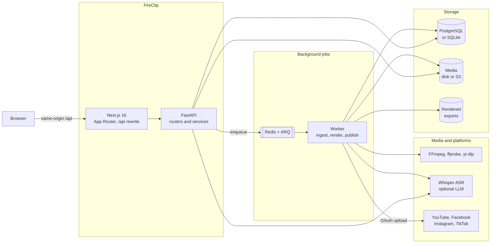
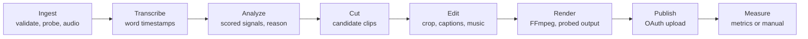

<p align="center">
  
</p>

<h1 align="center">FireClip</h1>

<p align="center">
  <strong>Turn long videos into ready-to-post clips, on your own infrastructure.</strong><br />
  Self-hosted AI clipping, editing, rendering and publishing.
</p>

<p align="center">
  <a href="https://github.com/rahulxdevv/FireClip/actions/workflows/ci.yml"></a>
  
  
  
  
  <a href="./LICENSE"></a>
</p>

<p align="center">
  
  
  
  
  
  
  
  
</p>

Give FireClip a podcast, interview, webinar or stream. It transcribes it, scores the moments worth clipping with a reason you can audit, gives you a timeline to edit, renders vertical clips with FFmpeg, and publishes to YouTube, Facebook, Instagram or TikTok through your own OAuth apps.

> **Honesty by design.** If a model, API key or platform permission is missing, FireClip says so and records the real error. It never fabricates clips, analytics, uploads or connections.

## Quick start

Docker Compose starts PostgreSQL, Redis, the API, a worker and the web app:

```bash
git clone https://github.com/rahulxdevv/FireClip.git
cd FireClip
cp .env.example .env
python -c "import secrets; print(secrets.token_urlsafe(48))"   # paste into JWT_SECRET
docker compose up --build -d
```

Open **http://localhost:3000** and register - the first account becomes owner of a workspace.

| Service | URL |
| --- | --- |
| Web app | http://localhost:3000 |
| API | http://localhost:8000 |
| OpenAPI docs | http://localhost:8000/docs |

If 3000 or 8000 is already taken, set `WEB_PORT` and `API_PORT` in `.env` before starting. Compose binds the containers to those numbers too, so the app, the host mapping and any reverse proxy all agree.

Without Docker (Python 3.10-3.12, Node 20+, FFmpeg and ffprobe on `PATH`):

```bash
cd backend && python -m venv .venv && ./.venv/Scripts/pip install -r requirements.txt
cd ../frontend && npm install
cd .. && cp .env.example .env
node scripts/dev.mjs        # starts API and web together, ports read from .env
```

Want it in the cloud instead? The [Render blueprint](https://render.com/deploy?repo=https://github.com/rahulxdevv/FireClip) builds the included all-in-one image.

### Your first clip

1. Upload an MP4/MOV, or import a public video URL.
2. Wait for ingest, transcription and analysis - each stage and any real error is shown.
3. Open **Clip discovery**, approve a candidate, then **Open in editor**.
4. Adjust crop and captions, choose a preset, hit **Render**, download from **Exports**.

## Architecture



Publishing goes out through each platform's official API using your own OAuth app; progress and failures are stored verbatim rather than retried into silence.

## Pipeline



Each stage is a real background job, not a request handler, so a long source never blocks the UI. The same task callables run under ARQ in Docker and inline locally. Details in [Architecture](docs/architecture.md).

## Features

| Area | What you get |
| --- | --- |
| Ingest | Streamed uploads with validation, URL import via yt-dlp, SSRF protection |
| Transcription | faster-whisper or OpenAI Whisper, word timestamps, editable segments |
| Clip discovery | Explainable offline scoring, or OpenAI, Anthropic, Gemini, Ollama |
| Editor | Timeline, trim, crop keyframes, face-anchored auto-crop, caption styles, overlays, music, fades, undo/redo |
| Rendering | 9:16, 1:1, 16:9 and 4:5 presets, MP4/MOV/WebM, burned ASS captions, loudness normalization |
| Publishing | YouTube, Facebook, Instagram Reels and TikTok, with scheduling and retries |
| Analytics | Platform metric sync, plus manual numbers labelled by source |
| Live | Record public YouTube, Twitch or Kick streams into the same pipeline |
| Teams | Workspaces with owner/admin/editor/viewer roles, email invitations, audit log |
| Review | Threaded clip comments with resolve state, bulk approve/reject/merge/delete |
| Sharing | Password-protected, expiring public links for any export, with view counts |
| Billing | Free/starter/studio/agency plans, Stripe Checkout and portal, invoices, webhook sync |
| Email | SMTP verification, password reset and invitations; falls back to logged links when unconfigured |
| Webhooks | HMAC-signed event delivery with retries, delivery log and test endpoint |

Transcription, LLM providers, publishing, SMTP and payments need your own credentials. Every unconfigured provider reports that honestly instead of faking success. The full status table is in [Architecture](docs/architecture.md#feature-status).

## Configuration

Everything is environment-driven, and [`.env.example`](.env.example) documents each option. The ones that matter first:

| Variable | Default | Why it matters |
| --- | --- | --- |
| `JWT_SECRET` | dev value | **Required in production.** Signs sessions and derives the AES key for stored provider tokens. |
| `DATABASE_URL` | SQLite | Point it at PostgreSQL for anything beyond a demo. |
| `REDIS_URL` | empty | Enables the ARQ worker; without it jobs run inline. |
| `FRONTEND_URL`, `BACKEND_PUBLIC_URL` | localhost | Public origins used for OAuth callbacks and CORS. |
| `COOKIE_SECURE` | `false` | Set `true` behind TLS. |

Full variable list, ports by deployment type and performance tuning: [Configuration](docs/configuration.md).

## Deploy

| Target | How |
| --- | --- |
| VPS with Docker | `docker compose up --build -d`, then proxy the web and API ports and terminate TLS |
| Render | [One-click blueprint](https://render.com/deploy?repo=https://github.com/rahulxdevv/FireClip) - the free plan sleeps, has 512 MB and ephemeral media |
| Dokploy | Compose application with `JWT_SECRET` set; PostgreSQL and Redis come with the stack |

Proxy examples, backups, scaling and an operations checklist: [Deployment](docs/deployment.md).

## Docs

| Document | Covers |
| --- | --- |
| [Configuration](docs/configuration.md) | Requirements, every variable, ports, tuning |
| [Deployment](docs/deployment.md) | Render, VPS, Dokploy, production self-hosting |
| [Guides](docs/guides.md) | Speech recognition, AI providers, OAuth publishing, S3, live recording |
| [Troubleshooting](docs/troubleshooting.md) | Symptoms, fixes, known limitations |
| [Architecture](docs/architecture.md) | Pipeline, feature status, project structure |
| [Roadmap](docs/roadmap.md) | What's next, what isn't planned |
| [Third-party licenses](docs/licensing.md) | Dependency licenses |

## Status

The backend suite (45 tests), the TypeScript check, the production build and ESLint all run in CI on every push. Docker images, the Render blueprint and live OAuth/AI calls are not exercised there because they need a Docker host or real credentials. Known gaps: [Troubleshooting](docs/troubleshooting.md#known-limitations).

## Security

- bcrypt password hashing, HTTP-only JWT cookies, API keys stored as hashes with a visible prefix.
- Provider and OAuth tokens encrypted with AES-GCM derived from `JWT_SECRET`.
- Workspace-scoped media, SSRF-guarded URL imports and webhooks, audit logs and rate limits.
- Share links use optional bcrypt-hashed passwords, expiry, revocation and short-lived media tokens.
- Back up `JWT_SECRET`: losing it invalidates sessions and makes encrypted tokens unrecoverable.

## License

[AGPL-3.0](LICENSE). Self-host it, modify it and use it commercially; if you run a modified FireClip as a network service, offer your users the source. Commercial licensing: [rahulxdevv@proton.me](mailto:rahulxdevv@proton.me).

---

<p align="center">
  Built by <a href="https://github.com/rahulxdevv">Rahul (@rahulxdevv)</a>.<br />
  If FireClip saves you an editing session, a star helps other people find it.
</p>